Definitions

- OTAs - Online Travel Agencies such as Booking.com, Airbnb
- Channel Manager - a piece of software that sits between your hotel and all the online travel agencies. Keeps your availability, rates, and reservations in sync across all of them automatically
- Commit - the moment a database makes all the changes in a transaction permanent and visible to everyone.
- Outbox table - just a regular database table where you store "messages you still need to send" — instead of sending them immediately. It's your to-do list for external calls (like notifying the channel manager), living right inside your own database.

# Higher Level

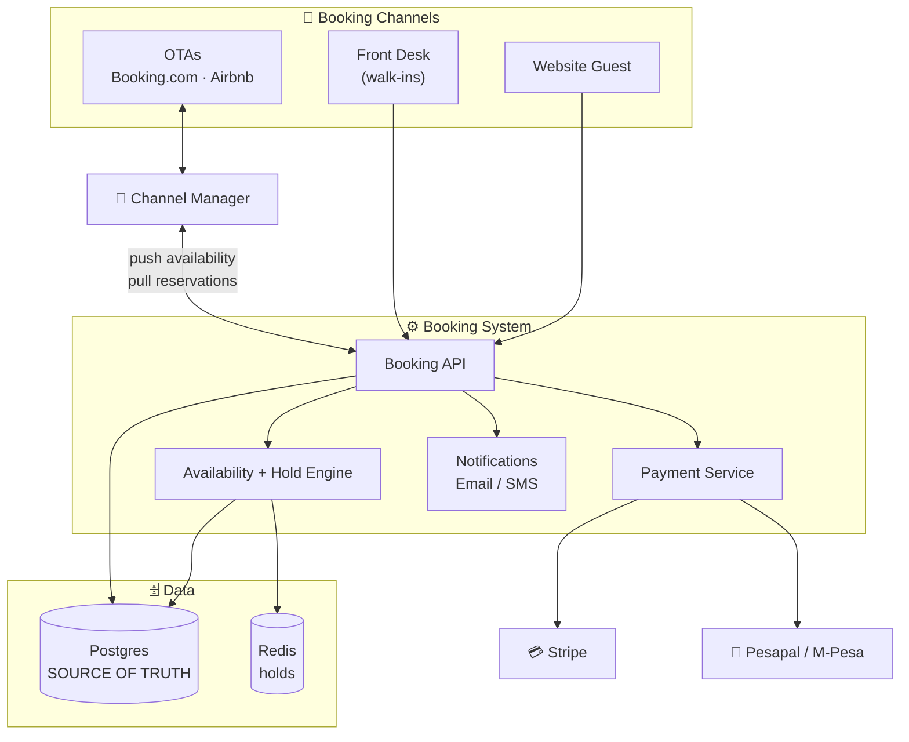

# Availability + Hold Engine (Our Website Only)

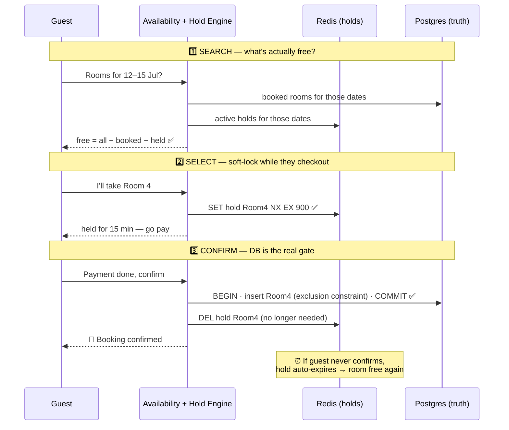

- holds could live in Postgres, but Redis is a much better fit for this specific job. The key reason: a hold is temporary, high-churn, throwaway data — and Redis is built exactly for that
- OTAs don't use this mechanism, we only receive from the OTAs once the place is booked. So we skip the hold entirely and go straight to writing the confirmed booking into Postgres
- **This means OTA bookings win every time, since they have already been confirmed.**

# Booking Flows

**Push Availability to OTA**

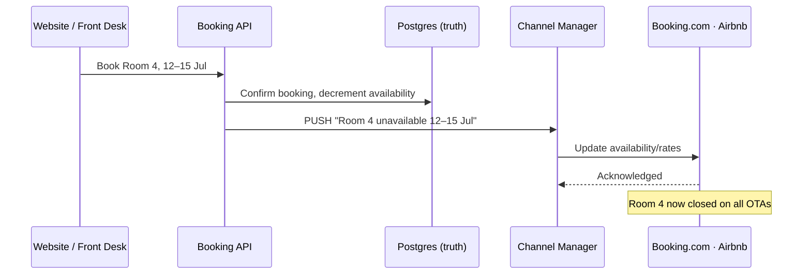

**Pull Availability from OTA**

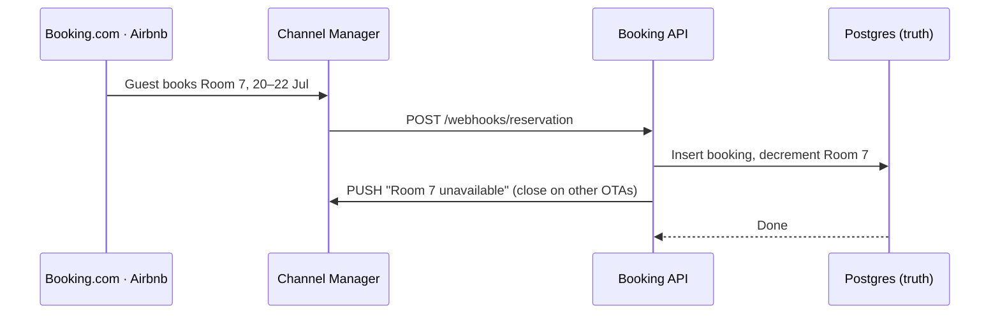

**Notes**

- Update the database first, then notify the channel manager
- Push can fail but it shouldn't block the user. Notify the user and enqueue the channel manager to push in the background for retries
- Make sure any DB updates are sync calls, we can't continue until we get DB write confirmation

# Race Conditions

**Two bookings, same room, same instant**

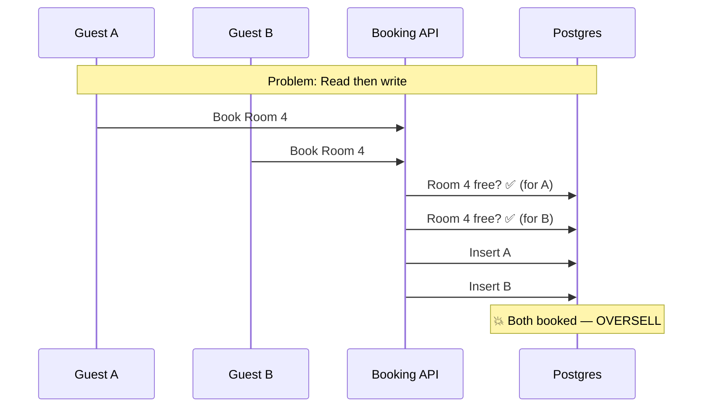

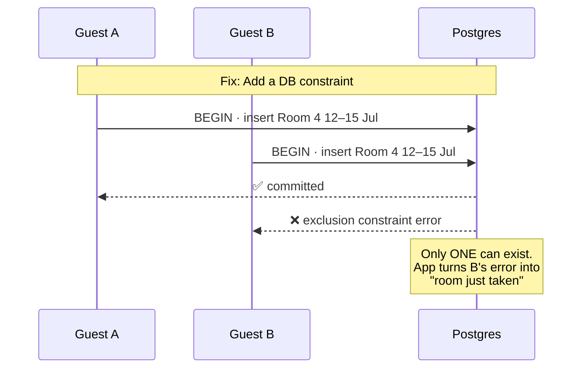

Main fixes for the above:

- Add a DB constraint to stop the overwrite happening twice
- Ensure that DB writes are awaited for before sending off confirmation emails

**Hold Race**

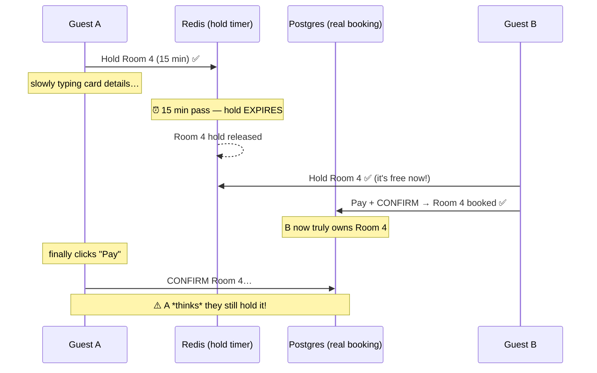

**Simple Fix**: Never trust the hold, re-check at commit

- The hold is only for UX — it stops two people racing into the same checkout at the same moment.
- The database is the only real proof of a booking. At commit time, you always re-check against the DB, never the hold.
- **Problem is how can we can handle this when we don't own the DB for OTAs. If it two users booked** - TODO: BIGGEST THING WE NEED TO LOOK AT ITS CALLED `sync-lag oversell`

**Push failure → transactional outbox**

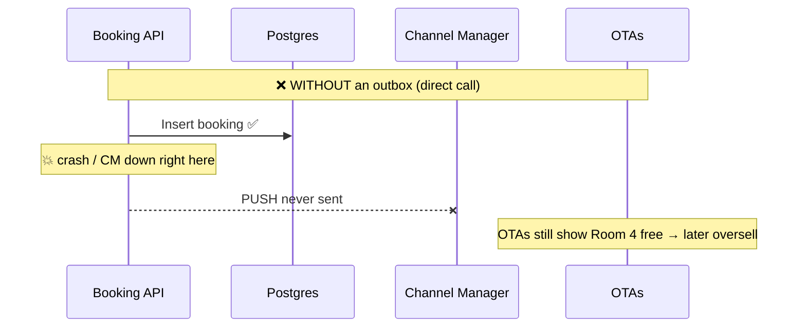

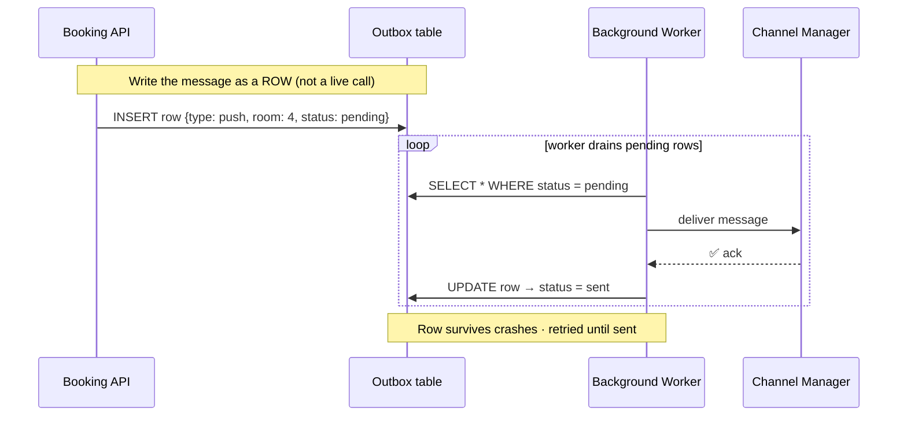

- The idea is that instead of directly writing to the Database and then sending the push event to channel manager
- We create an outbox table (see def above)
- This allows retries to happen in case the server crashes

**Duplicate / out-of-order webhooks**

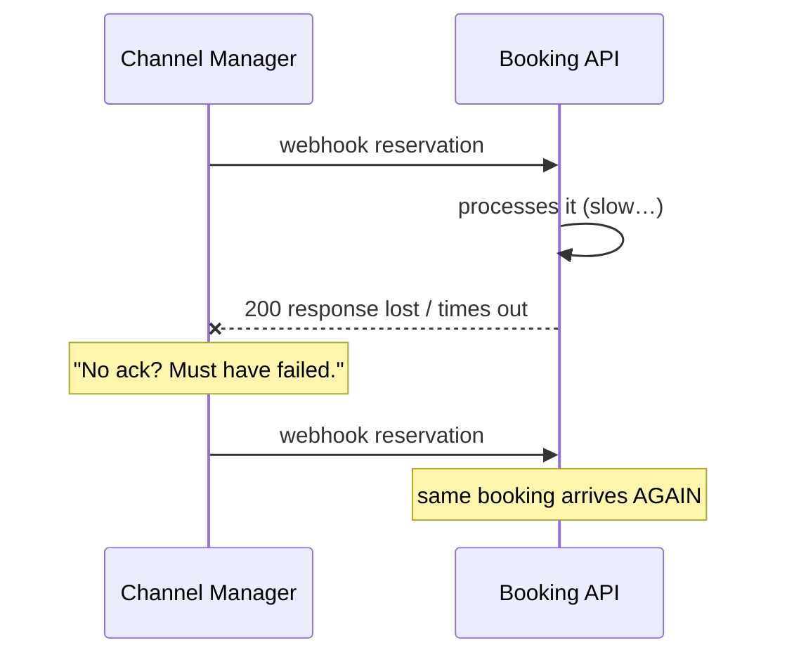

- The channel manager didn't hear back in time, so it assumes failure and resends
- The catch is we've processed it but not sent a 200 back.
- This can cause duplication of bookings

The Fix is simple just add an idempotency key

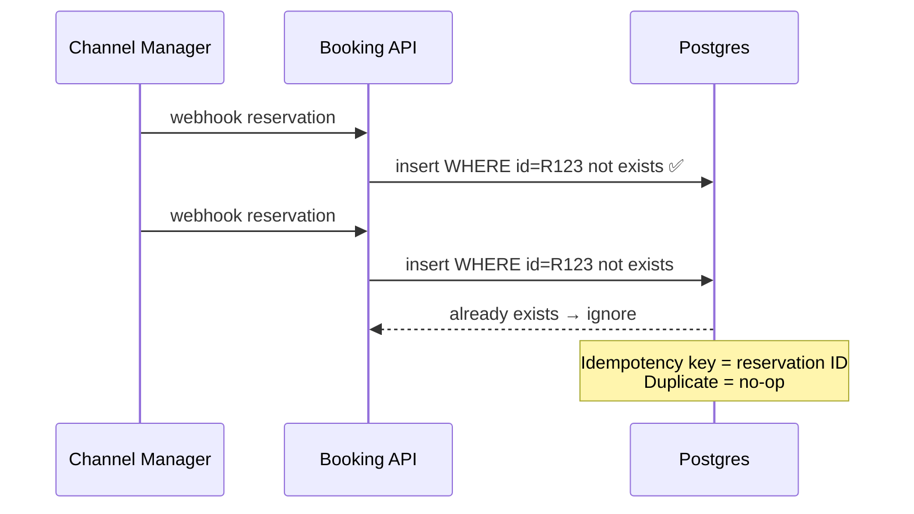

# Implementation Plan

Build in thin, testable slices. Each phase ships something we can use and verify before moving on. The trick is to **front-load the riskiest integration (OTA sync) first** by leaning on Booking.com as the source of truth, then gradually bring control in-house.

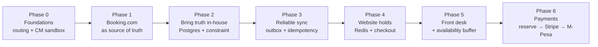

## Phase 0 — Foundations & spike

- **Goal:** a skeleton we can build on, and a working channel-manager connection.
- **Build:** Next.js app with real routing (replace the `activeTab` state); sign up for a channel manager (Channex / Beds24) sandbox; connect a Booking.com test property to it.
- **Test ✅:** we can read availability and push a test reservation through the channel manager API.

## Phase 1 — Booking.com as the source of truth

- **Goal:** a working end-to-end booking with minimal infrastructure. No Postgres availability engine, no Redis holds yet — the website is a custom front-end onto the channel manager, and **Booking.com (via the channel manager) owns the inventory**.
- **Build:** website reads live availability from the channel manager; a website booking is pushed straight to the channel manager so it appears on Booking.com. Reserve-only (no payment).
- **Test ✅:**
  - Book on the site → it shows up in Booking.com.
  - Book on Booking.com → the site shows that room as unavailable.
- **Why first:** this de-risks the hardest part (OTA sync) immediately and avoids building the availability engine prematurely. Trade-off: we accept sync-lag and have no exclusion-constraint guard yet — acceptable at low volume for a single property.

## Phase 2 — Bring the source of truth in-house

- **Goal:** own our inventory so we get the oversell guarantee.
- **Build:** introduce Postgres as the source of truth with the **exclusion constraint**; channel manager now syncs two-way (push our bookings, pull OTA reservations via webhook).
- **Test ✅:** two concurrent bookings for the same room → exactly one wins; a pulled OTA reservation correctly closes the room on the site.

## Phase 3 — Reliable sync

- **Goal:** never lose a push, never double-count a webhook.
- **Build:** transactional **outbox** + background worker for pushes; **idempotency key** (reservation ID) on incoming webhooks.
- **Test ✅:** kill the server mid-booking → push still delivered on restart; channel manager down → retried until acked; duplicate webhook → no-op.

## Phase 4 — Website holds & checkout UX

- **Goal:** a smooth multi-step checkout that doesn't let two website guests collide.
- **Build:** Redis **holds** (`SET NX EX`); availability = total − booked − held; multi-step checkout page.
- **Test ✅:** a held room can't be held by a second guest; an abandoned checkout auto-frees the room after the TTL; final confirm still re-checks the DB.

## Phase 5 — Front desk & availability buffer

- **Goal:** support walk-ins and protect desk inventory from OTA last-room races.
- **Build:** admin booking screen (instant commit + immediate push); **availability buffer** to hold back the last 1–2 rooms from OTAs.
- **Test ✅:** a desk booking commits instantly and closes the room on OTAs; with a buffer of 1, the OTAs can never sell the final room.

## Phase 6 — Payments (staged)

- **Goal:** take money, rolled out in low-risk stages.
- **Build:** reserve-only → **Stripe** (tourists/cards) → **Pesapal / M-Pesa** (locals); refunds + payment status on bookings.
- **Test ✅:** each provider works end-to-end in sandbox; a failed payment never leaves a confirmed booking.

> TODO: revisit `sync-lag oversell` (see Race Conditions) before relying on Postgres as the sole source of truth in Phase 2 — the buffer in Phase 5 is the main mitigation.
