Definitions

- OTAs - Online Travel Agencies such as Booking.com, Airbnb
- Channel Manager - a piece of software that sits between your hotel and all the online travel agencies. Keeps your availability, rates, and reservations in sync across all of them automatically
- Commit - the moment a database makes all the changes in a transaction permanent and visible to everyone.
- Outbox table - just a regular database table where you store "messages you still need to send" — instead of sending them immediately. It's your to-do list for external calls (like notifying the channel manager), living right inside your own database.

# Higher Level

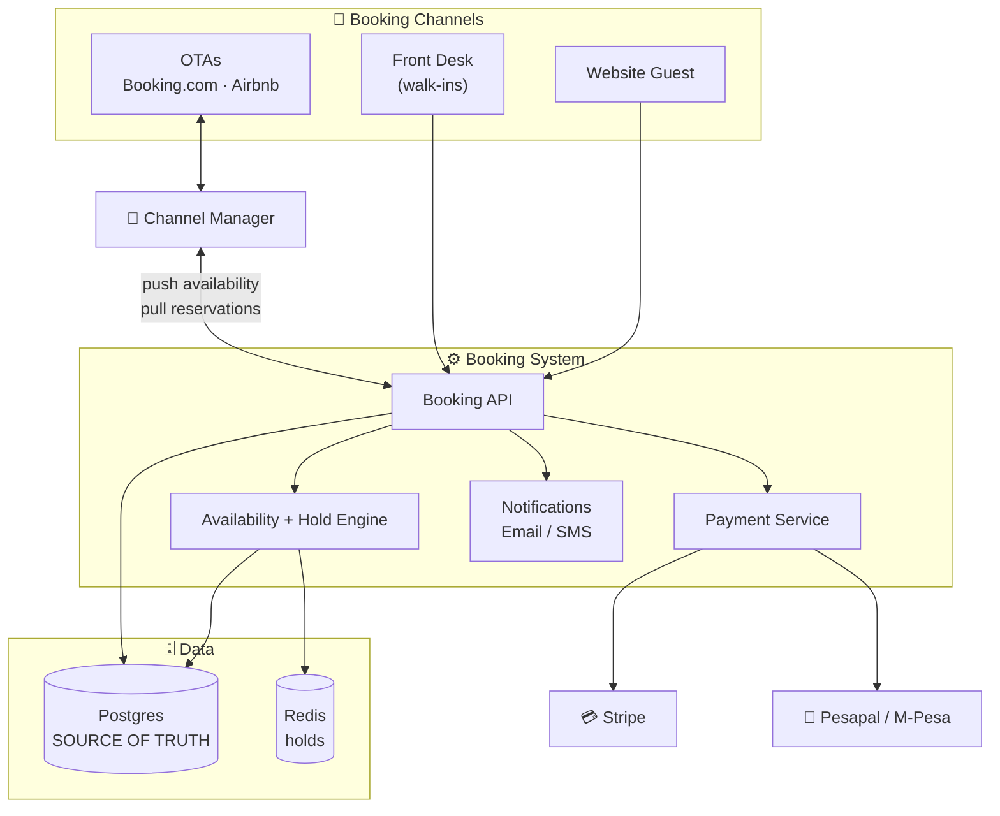

# Availability + Hold Engine (Our Website Only)

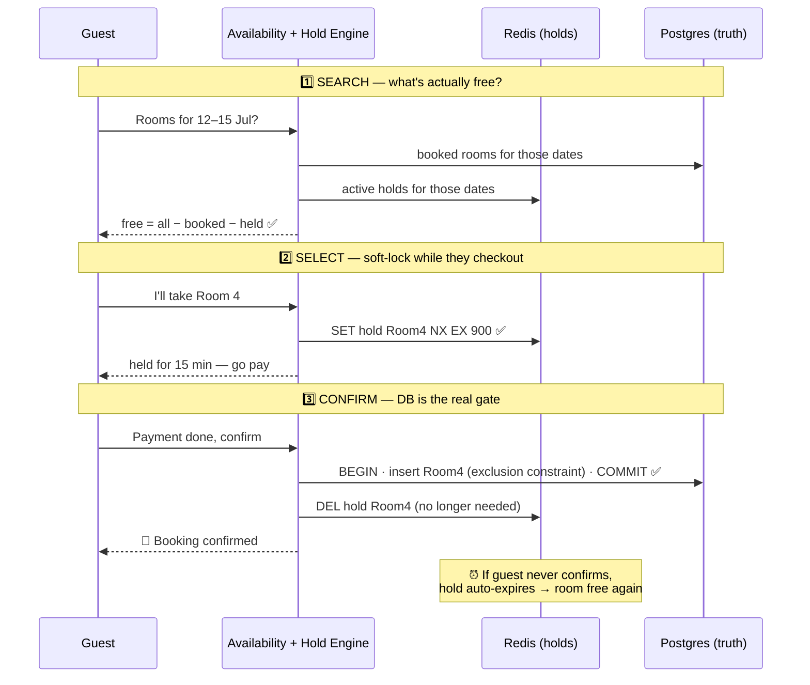

- holds could live in Postgres, but Redis is a much better fit for this specific job. The key reason: a hold is temporary, high-churn, throwaway data — and Redis is built exactly for that
- OTAs don't use this mechanism, we only receive from the OTAs once the place is booked. So we skip the hold entirely and go straight to writing the confirmed booking into Postgres
- **This means OTA bookings win every time, since they have already been confirmed.**

# Booking Flows

**Push Availability to OTA**

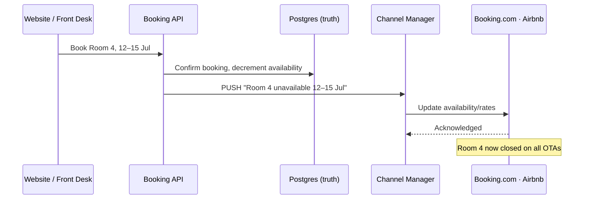

**Pull Availability from OTA**

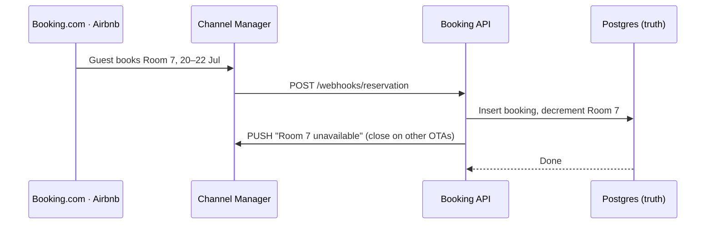

**Notes**

- Update the database first, then notify the channel manager
- Push can fail but it shouldn't block the user. Notify the user and enqueue the channel manager to push in the background for retires
- Make sure any DB updates are sync calls, we can't continue until we get DB write confirmation

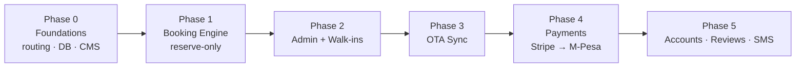

# Race Conditions

**Two bookings, same room, same instant**

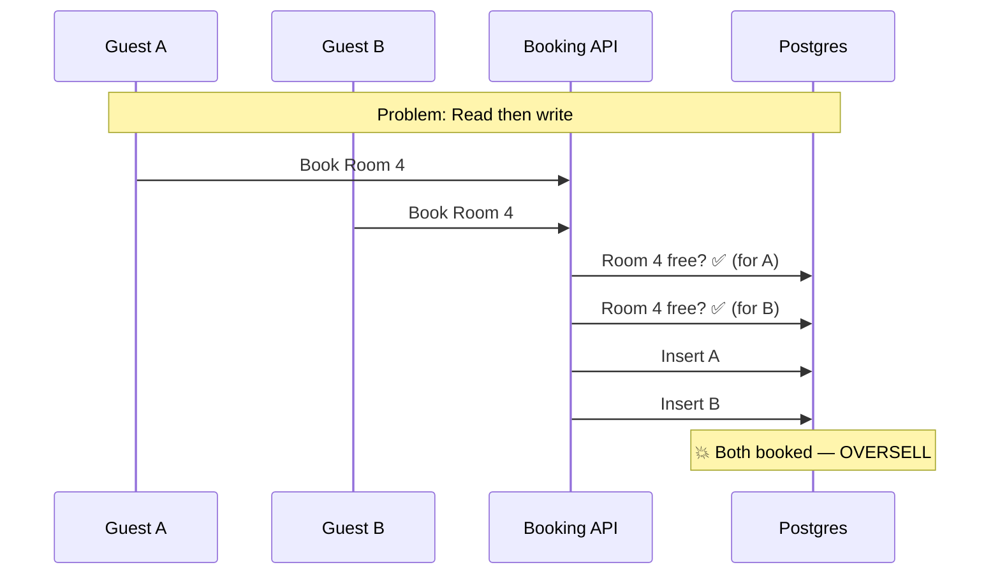

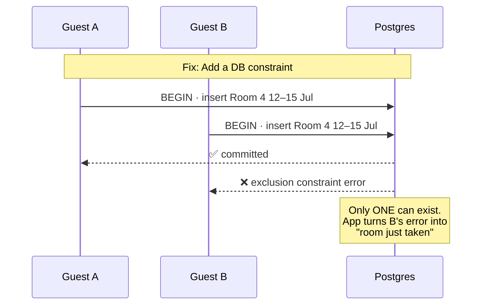

Main fixes for the above:

- Add a DB constraint to stop the overwrite happening twice
- Ensure that DB writes are awaited for before sending off confirmation emails

**Hold Race**

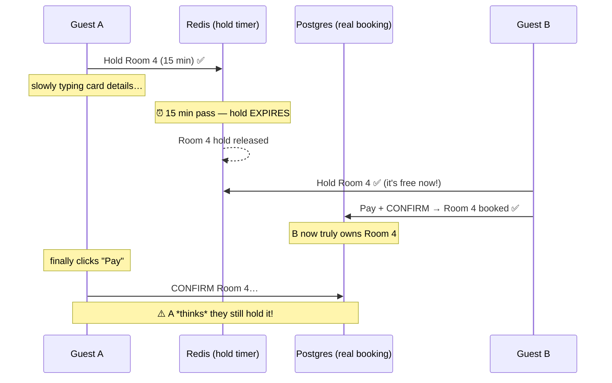

**Simple Fix**: Never trust the hold, re check at commit

- The hold is only for UX — it stops two people racing into the same checkout at the same moment.
- The database is the only real proof of a booking. At commit time, you always re-check against the DB, never the hold.
- **Problem is how can we can handle this when we don't own the DB for OTAs. If it two users booked** - TODO: BIGGEST THING WE NEED TO LOOK AT ITS CALLED `sync-lag oversell`

**Push failure → transactional outbox**

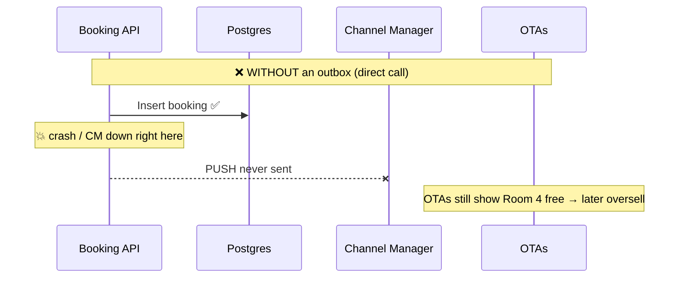

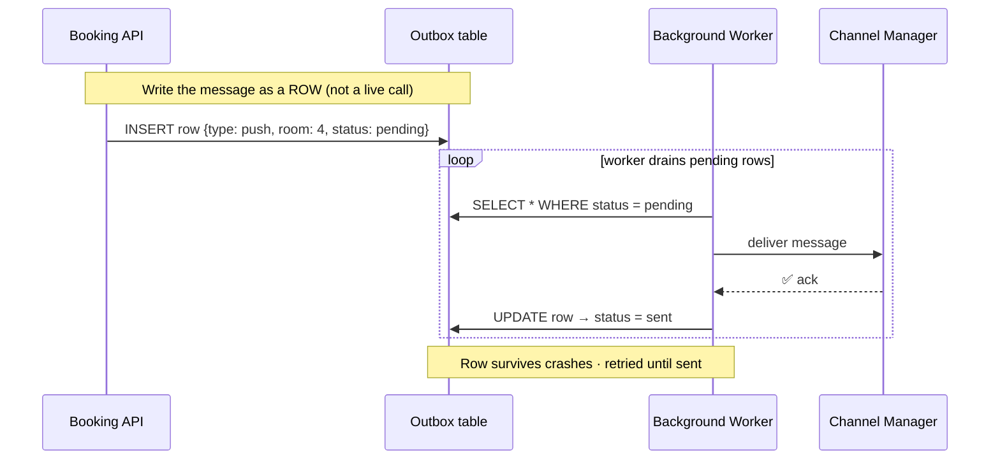

- The idea is that instead of directly writing to the Database and then sending the push event to channel manager
- We create an outbox table (see def above)
- This allow for retries to happen incase the server crashes

**Duplicate / out-of-order webhooks**

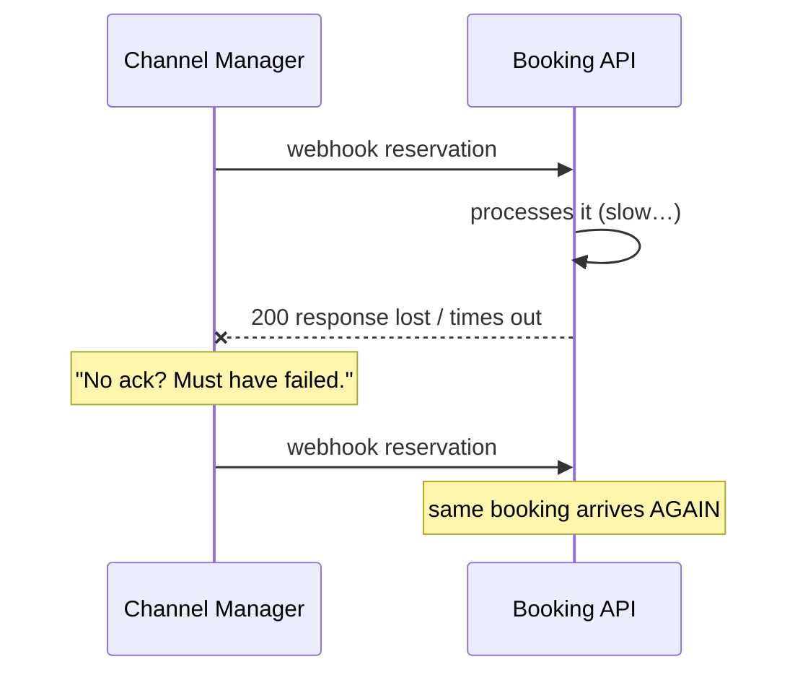

- The channel manager didn't hear back in time, so it assumes failure and resends
- The catch is we've processed it but not sent a 200 back.
- This can cause duplication of bookings

The Fix is simple just add an idempotency key

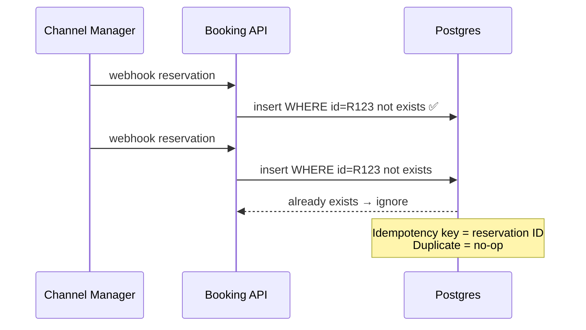
